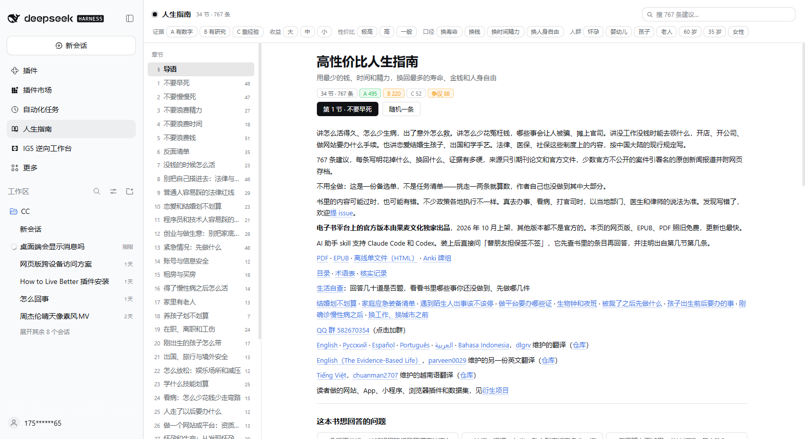

# dsh-howtolivebetter · 人生指南

把 **[《高性价比人生指南》](https://github.com/eternity4719/HowToLiveBetter)** 装进 [DeepSeek Harness](https://github.com/deepseek-ai/dsh) 的侧栏：多一个「人生指南」图标，主面板里是一本可以按节翻阅、全文检索、按条件筛选的书。

原书 34 节 767 条建议，每条都带成本、收益、证据等级、逐条来源和一句「说人话」的总结。插件把正文离线打包进 `data/`（约 3.3 MB）：**点开即读，不联网，无第三方依赖，无构建步骤。**

A DeepSeek Harness plugin that puts the Chinese guide *HowToLiveBetter* — 34 chapters, 767 evidence-graded suggestions with cost, payoff and sources — into a sidebar panel. Offline, searchable, filterable, zero dependencies.



## 装法

**1. 市场里装**：打开 DSH 左侧「插件市场」，搜 `dsh-howtolivebetter`，点安装。

**2. 命令行装**：

```bash
dsh plugin --profile desktop add dsh-howtolivebetter   # profile 换成你在用的（desktop / web）
```

**3. 从源码装**：

```bash
git clone https://github.com/Azhe0306/dsh-howtolivebetter.git
dsh plugin --profile desktop add ./dsh-howtolivebetter
```

装完**重启一次 DSH**（客户端模块有缓存，热更不一定会重新拉页面模块）。之后侧栏出现「人生指南」图标。

## 界面

- **左侧目录**：导语 + 34 节，带每节条目数。
- **顶部筛选**：证据等级（A/B/C）、收益量级（大/中/小）、性价比（极高/高/一般）、口径（换寿命/换钱/换时间精力/换人身自由）、人群（怀孕/婴幼儿/孩子/老人/60 岁/35 岁/女性）。组内多选取并集，组间取交集。
- **搜索**：边打边搜，空格分词、各词都要命中；标题、「说人话」、收益、成本和节名都参与匹配。
- **条目**：编号、标题、徽章、「说人话」正文、成本、收益；「备注」和「来源」默认收起。正文里「见第 8 节第 17 条」这类互相指路可以直接点，会跳到对应条并闪一下。
- **导语页**：原书导语、34 个「这本书想回答的问题」、怎么读 / 四种资源 / 证据分级 / 性价比档 / 术语表 / 许可。

## 数据从哪来

`data/` 是用仓库里的生成脚本从原书 markdown 解析出来的，不手抄：

```bash
git clone --depth 1 https://github.com/eternity4719/HowToLiveBetter.git vendor/HowToLiveBetter
node tools/build-data.mjs                      # 默认读 vendor/HowToLiveBetter
node tools/build-data.mjs <原仓库目录>          # 或指定路径 / 或设 HTLB_SRC
```

- 条目从 `book/NN-标题.md` 的 `### N. 标题` 切；成本标签读 `<!-- 成本标签: 钱=0 时间=少 毅力=否 收益=大 口径=死亡率 -->`；性价比按原书 `tools/lib/book.mjs` 里的 `COST_W` / `ratioOf` 重算，和官网检索页同一套口径。
- 输出：`data/meta.json`（导语、问题、读法、术语表、目录）、`data/search.json`（检索索引）、`data/chapters/01..34.json`。
- 生成时会校验字段完整性和各项计数（34 节 / 767 条 / A495 B220 C52 / 极高123 高344 一般300 / 争议88），对不上就报错，不会静默产出半成品。

已发布数据对应原仓库 commit `e2605d3e`（2026-10-21）。

## 自检

浏览器那半边带一个无头渲染冒烟测试，不用装进客户端就能跑（`windows` / `linux` / `macos` 都行）：

```bash
node tools/smoke-test.mjs      # 或 npm test
```

它用最小化的假 React 驱动 `client.js`，检查五件事：导语页（34 个问题、6 个折叠块）、点开第 13 节能渲染出条目卡、搜「加班费」有命中且点结果能跳过去、点证据 A 筛选后条目变少、点「随机一条」能落到某一节。有一条不过就以退出码 1 结束。

指定 `HTLB_HTTP` 就改成走已装插件的真实接口，验证宿主路由 + 面板的完整链路：

```bash
HTLB_HTTP=http://127.0.0.1:11452 node tools/smoke-test.mjs
```

## 技术形态

- **宿主半边 `index.js`**：`inject: ['webServer']`，只注册三条只读接口 —— `GET /howtolivebetter/api/meta`、`/search`、`/chapter/<n>`；内存缓存 JSON，`no-store`，只接受 GET/HEAD。
- **浏览器半边 `client.js`**：`window.__ModuleLoader__.load` + `require('react')`，往 `sidebar.panellist` 注册图标（id `howtolivebetter`，order 20），往 `main` 注册同键面板。样式全用 `--dsw-*` 主题变量，跟随深浅色和字号；窄面板下目录自动变成横向条。
- **没有第三方依赖，没有构建步骤**，正文数据随包发布；`npm install` 不会编译任何东西。

## 许可与署名

本仓库两部分内容分别适用不同许可，合起来是 **MIT AND CC-BY-4.0**：

| 部分 | 许可 | 说明 |
| --- | --- | --- |
| `index.js`、`client.js`、`tools/`、`locale/`、`icon.svg` | MIT | 见 [LICENSE](LICENSE) |
| `data/` 里的正文（来自原书） | CC BY 4.0 | 见 [NOTICE](NOTICE)、[LICENSE-CC-BY-4.0](LICENSE-CC-BY-4.0) |

- 原书：**《高性价比人生指南》** — <https://github.com/eternity4719/HowToLiveBetter>，作者 eternity4719，正文按 [CC BY 4.0](https://creativecommons.org/licenses/by/4.0/) 发布。
- 本插件只把正文结构化并做成阅读界面，**不改写正文**；「说人话」等文字照原文抄录。
- **非官方实现**：与原书作者无关，未获其背书，也不代表原作者观点。插件不替代医生、律师、会计；书里内容可能过时或有误，请以当地部门、医生、律师为准。

## 相关

- 想让模型自己查这本书再回答（而不是你自己翻），装同作者的 skill 插件：[`dsh-life-decision-guide`](https://github.com/MonkeyGarry/dsh-life-decision-guide)（注册 `life-decision-guide` skill + 三个查询工具）。
